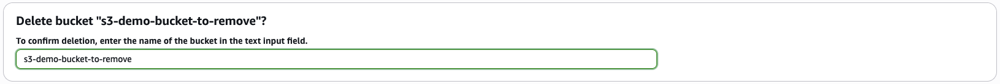

# AWS Confirmation Autofill (Firefox Extension)

This extension automatically detects and populates confirmation fields in the AWS Management Console (e.g. `permanently delete`, `delete`, or exact resource names) without auto-submitting.

## Installation
Install via [Firefox add-ons](TODO link).

#### Or install locally
* Clone this repo
* In Firefox navigate to `about:debugging` > This Firefox > Load Temporary Add-on
* Select `manifest.json` from the cloned repo
